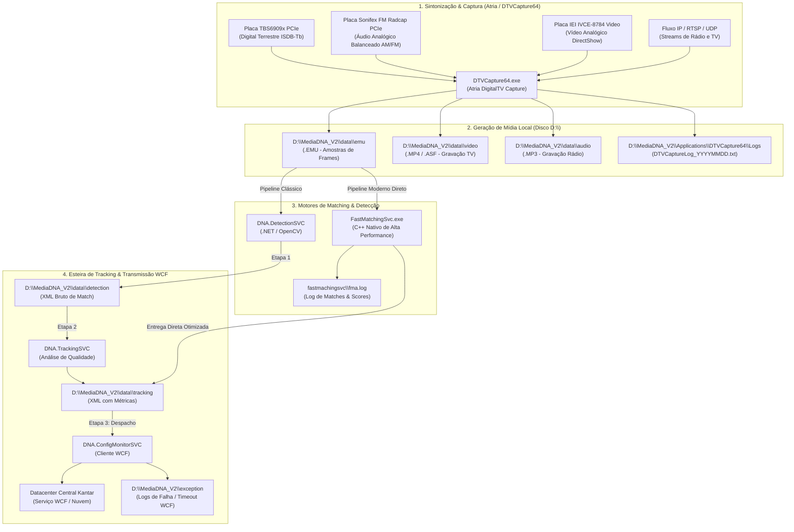

# ARQUITETURA FORENSE DE CAPTURE SITES: ATRIA CAPTURE, FASTMCHINGSVC & ESTEIRA WCF
**Kantar IBOPE Media — Engenharia de Sistemas & NOC Broadcast**  
**Documento Canônico de Arquitetura, Diagnóstico Forense e Diretrizes Estratégicas**

---

## 1. Visão Geral da Topologia dos Capture Sites (CS)

Os Capture Sites são as estações remotas distribuídas em todas as capitais e praças estratégicas do Brasil, responsáveis por sintonizar, demodular, capturar, gravar e reconhecer comerciais publicitários em tempo real.



---

## 2. FastMatchingSvc vs. DNA.DetectionSVC: A Revelação do `fma.log`

### 2.1 O Papel do `FastMatchingSvc`
- **Localização**: `D:\MediaDNA_V2\applications\dtvcapture64\fastmachingsvc\` (ou `fastmatchingsvc`).
- **Arquivo de Log Mestre**: `fma.log` (Fast Matching Agent Log).
- **Mecânica Operacional**:
  - Enquanto o `DNA.DetectionSVC` é o serviço legado baseado em .NET Framework e chamadas P/Invoke para OpenCV, o `FastMatchingSvc` é uma biblioteca/serviço compilado nativamente em C++ de alta densidade computacional.
  - Ele lê os blocos `.EMU` gerados pelo `DTVCapture64` e compara a assinatura visual contra a base local de spots comerciais (`.MDNA`).
  - **Entrega Direta no Tracking**: No modo avançado, o `FastMatchingSvc` consolida o match e as métricas de qualidade de forma atômica e grava o XML final diretamente em `D:\MediaDNA_V2\data\tracking`. Isso pula o passo intermediário de gravar em `data\detection` para depois o `DNA.TrackingSVC` reabrir o arquivo, eliminando I/O desnecessário de disco no volume `D:`.

### 2.2 Estrutura do `fma.log`
O `fma.log` registra cada ciclo de varredura do motor:
```text
[2026-10-30 01:25:12.450] [INFO] [FMA] Matching cycle start. EMU Block: 20261030_012500_CH01.EMU
[2026-10-30 01:25:12.610] [MATCH] SpotID: 48921 | Confidence: 98.4% | Channel: 3186 | Duration: 30s | Offset: 00:14:22
[2026-10-30 01:25:12.615] [INFO] [FMA] Output written directly to D:\MediaDNA_V2\data\tracking\TRK_48921_20261030012512.xml
[2026-10-30 01:25:12.620] [PERF] Block processed in 170ms (Throughput: 5.8x real-time).
```

### 2.3 Risco Crítico: Conflito Concorrente de Motores
- Se o `FastMatchingSvc` e o `DNA.DetectionSVC` estiverem ambos com status `Em Execução` no mesmo nó, ocorre:
  1. Conflito de lock nos arquivos `.EMU`.
  2. Duplicidade de detecções enviadas para a Matriz.
  3. Desperdício de até 70% de CPU da máquina.
- **Diretriz**: Em praças modernas, manter o `FastMatchingSvc` ativo e o `DNA.DetectionSVC` desativado/parado.

---

## 3. O Gargalo de Acúmulo em `data\tracking` & Diagnóstico Forense WCF

### 3.1 Compreendendo o Sintoma
Quando uma estação apresenta acúmulo de arquivos XML em `D:\MediaDNA_V2\data\tracking` (como os 576 arquivos em Montes Claros CS01):
- **O que está funcionando perfeitamente**: A captura (`DTVCapture64`), a demultiplexação, e o matching (`DNA.DetectionSVC` ou `FastMatchingSvc`). Eles já geraram os XMLs!
- **Onde está a causa raiz**: No **`DNA.ConfigMonitorSVC`**! É esse serviço que lê de `data\tracking`, serializa o pacote e envia via WCF (Windows Communication Foundation) para o endpoint central.

### 3.2 Pastas de Auditoria Forense
1. **`D:\MediaDNA_V2\applications\DNA.ConfigMonitorSVC\ConfigMonitorSVC.exe.config`**:
   - Contém a seção `<system.serviceModel>`:
   ```xml
   <bindings>
     <basicHttpBinding>
       <binding name="BasicHttpBinding_ITrackingService" 
                sendTimeout="00:05:00" 
                maxReceivedMessageSize="2147483647" />
     </basicHttpBinding>
   </bindings>
   <client>
     <endpoint address="http://datacenter.kantar.com/TrackingService.svc" 
               binding="basicHttpBinding" 
               contract="ITrackingService" />
   </client>
   ```
2. **`D:\MediaDNA_V2\exception`**:
   - Quando o `ConfigMonitorSVC` falha em despachar para o WCF, ele grava a stack trace nessa pasta:
     - `System.ServiceModel.EndpointNotFoundException`: Endpoint fora do ar ou rota WAN interrompida.
     - `System.TimeoutException`: O envio demorou mais que `sendTimeout`.
     - `System.IO.FileLoadException`: Arquivo bloqueado por antivírus ou outro processo.

---

## 4. Hardware Real de Rádio e Vídeo Analógico: O Caso Florianópolis

### 4.1 Desmistificação de Placas Analógicas
- **Florianópolis CS01 (`CS-BRSC-FNS-DT0`)**:
  - **Áudio de Rádio FM** (`Atlantida FM 100.9`, `Band FM 96.1`, `Regional FM 106.5`):
    - Placa: **Sonifex FM Radcap PCIe** (Multicanal: Channel 1, Channel 2, Channel 3).
    - Formato de Saída: Arquivo de áudio **.MP3** contínuo (`D:\MediaDNA_V2\data\audio\`).
    - Estado de Operação: **100% NOMINAL**.
  - **Vídeo de Entrada**: Placa **IEI IVCE-8784 Video** (PCI DirectShow).
  - **Placas Yuan TW6802**: Existem apenas em praças analógicas antigas sem Sonifex. Rotular Florianópolis com placa Yuan é um erro conceitual e técnico.

### 4.2 Regra de Ouro do Classificador de Falhas
- **Rádios gravando MP3 (`gravando_mp3 == 'Sim'`) estão NOMINAIS**:
  - Rádios não produzem MP4/ASF. Nunca avaliar `gravando_mp4` em canais de rádio!
  - Toda interface e tabela deve exibir o **Hostname Físico Real** (ex: `CS-BRSC-FNS-DT0`) e o badge correto: `📻 Sonifex FM`.

---

## 5. Estratégia de Auto-Healing da Frota (Nós Desatualizados e Offline)

Para resolver a situação dos agentes defasados (`1.0.10.4`, `1.0.13.0`, `1.0.13.1`, `1.0.15.1`) e nós em delay:

1. **Rastreamento em 4 Quadrantes**:
   - **🟢 Atualizados**: Agentes online com build `v1.0.16.0`.
   - **🟠 Elegíveis para Auto-Healing**: Agentes online com versão `< 1.0.16.0`.
   - **🟡 Em Delay**: 2h a 6h sem envio de telemetria.
   - **🔴 Offline Crítico**: >24h sem reporte.
2. **Ação de Auto-Healing em 1 Clique (`POST /api/fleet/auto-healing/run`)**:
   - Varre a frota e aplica no SharePoint:
     - `Versao_Desejada = '1.0.16.0'`
     - `Acao_Solicitada = 'Atualizar'`
   - Para estações com `FastMatchingSvc` ou `ConfigMonitorSVC` parados, aplica `Acao_Solicitada = 'Iniciar'`.
   - Executa a reciclagem defensiva da thread do WCF para destravar o consumo de `data\tracking`.

---

## 6. Playbook de Comandos Remotos Úteis (PowerShell)

```powershell
# 1. Inspecionar as últimas linhas do fma.log no FastMatching
Get-Content "D:\MediaDNA_V2\applications\dtvcapture64\fastmachingsvc\fma.log" -Tail 50

# 2. Auditar arquivos acumulados na pasta de tracking
(Get-ChildItem "D:\MediaDNA_V2\data\tracking\*.xml").Count

# 3. Consultar as últimas exceções de WCF / Dispatcher
Get-ChildItem "D:\MediaDNA_V2\exception\*.txt" | Sort-Object LastWriteTime -Descending | Select-Object -First 5 | Get-Content -Tail 20

# 4. Destravar ConfigMonitorSVC de forma segura
Restart-Service "DNA.ConfigMonitorSVC" -Force
```
