# ARQUITETURA DE ENGENHARIA: DETECÇÃO AUTOMÁTICA DE COMERCIAIS & ECOSSISTEMA MEDIADNA

> **Documento Oficial de Engenharia de Software e Operações de Campo (NOC / Fleet Control)**  
> **Escopo:** Estações de Captação Primárias (**CS01 exclusivamente**) • Pipeline de Matching de Mídia, Despacho WCF e Monitoração Proativa  
> **Versão do Documento:** 2.0 (Revisão Arquitetural Completa)

---

## 1. VISÃO GERAL E REGRA FUNDAMENTAL DE ESCOPO (LEI DO CS01)

> [!IMPORTANT]
> **A Detecção Automática de Novos Comerciais ocorre RESTRITAMENTE no Capture Site Primário (CS01).**  
> As estações **CS02 (Backup local)** e **CS03 (Backup terciário/Satélite)** dedicam-se à gravação redundante de fluxos brutos (`.ASF` / `.MP4` / `.MP3`) e sincronismo de áudio.  
> **Em hipótese alguma estações CS02 ou CS03 devem executar motores de matching ou serem avaliadas pelo monitor de detecção.**

### 1.1 Identificação Inequívoca da CS via `ConfigXml.xml`
Em caso de divergência em listas de inventário ou cadastros dinâmicos, a fonte canônica da verdade local no servidor é o arquivo:
`D:\mediadna_v2\data\config\configxml.xml`

Neste arquivo, a identidade da estação é definida pela tag XML:
```xml
<ConfigXml>
  <HostConfig>
    <IdHost>243</IdHost>
    <CS>1</CS>             <!-- 1 = CS01 (Detecção Ativa) | 2 = CS02 (Gravação Backup) -->
    <IdCS>1</IdCS>
    <Praca>Montes Claros</Praca>
  </HostConfig>
</ConfigXml>
```
O coletor de telemetria e o Dashboard validam a tag `<CS>1</CS>` antes de incluir qualquer estação no escopo da esteira de detecção.

---

## 2. ARQUITETURA COMPARATIVA DOS MOTORES DE MATCHING

Os serviços **`FastMatchingSvc`** e **`DNA.DetectionSVC`** são **ESTRITAMENTE CONCORRENTES E MUTUAMENTE EXCLUSIVOS**. Eles desempenham a **mesmíssima função**: confrontar os buffers de gravação de 1 minuto (`.EMU`) contra os spots comerciais (`.MDNA`) cadastrados.  
**Onde funciona um, NÃO DEVE funcionar o outro.**

```mermaid
flowchart TD
    subgraph INBOUND["1. Ingestão e Gravação Contínua"]
        ATRIA["Atria Capture / MediaRecorderSVC"] -->|Grava buffers de 1 min| EMU["D:\\mediadna_v2\\data\\emu\\ (*.EMU)"]
        CONF_MON["DNA.ConfigMonitorSVC"] -->|Baixa spots novos| SGG["D:\\mediadna_v2\\data\\sgg\\ (*.MDNA)"]
        CONF_MON -->|Atualiza catálogo| CFG_XML["D:\\mediadna_v2\\data\\config\\configxml.xml"]
    end

    subgraph PATH_A["2A. Caminho Moderno (FastMatchingSvc - Recomendado)"]
        EMU -.->|Leitura direta| FM["FastMatchingSvc.exe (C++ Nativo)"]
        SGG -.->|Confronto FFT/OpenCV| FM
        FM -->|Registra matches| FMA_LOG["D:\\mediadna_v2\\applications\\dtvcapture64\\fastmachingsvc\\fma.log"]
        FM ==>|Gera XML final DIRETO| TRK_DIR["D:\\mediadna_v2\\data\\tracking\\ (*.XML)"]
    end

    subgraph PATH_B["2B. Caminho Clássico (DetectionSVC + TrackingSVC - Legado)"]
        EMU -.->|Leitura| DET["DNA.DetectionSVC.exe (.NET 4.0)"]
        SGG -.->|Confronto FFT/OpenCV| DET
        DET -->|Gera XML intermediário| DET_DIR["D:\\mediadna_v2\\data\\detection\\ (*.XML)"]
        DET_DIR -->|Consome e valida qualidade| TRK_SVC["DNA.TrackingSVC.exe"]
        TRK_SVC -->|Gera XML final validado| TRK_DIR
    end

    subgraph OUTBOUND["3. Despacho Central WCF"]
        TRK_DIR -->|Consome XMLs de tracking| CONF_MON_OUT["DNA.ConfigMonitorSVC"]
        CONF_MON_OUT ==>|Transmissão HTTPS/WCF| WCF["https://mediadna.ibope.com/mediadnawcfcs/RemoteHostsService.svc"]
        CONF_MON_OUT -.->|Em caso de erro/rejeição| EXC["D:\\mediadna_v2\\data\\exception\\"]
        CONF_MON_OUT -.->|Falhas de parse/formato| FAIL["D:\\mediadna_v2\\data\\tracking\\failed\\"]
    end

    style PATH_A fill:#064e3b,stroke:#059669,stroke-width:2px;
    style PATH_B fill:#78350f,stroke:#d97706,stroke-width:2px;
    style OUTBOUND fill:#1e1b4b,stroke:#4f46e5,stroke-width:2px;
```



---

## 3. MAPEAMENTO DETALHADO DO PIPELINE & PAPEL DAS PASTAS

### 3.1 Fluxo Clássico (DetectionSVC + TrackingSVC)
1. **Geração do Buffer EMU**: O `Atria Capture` (ou `DNA.MediaRecorderSVC`) fatia a transmissão sintonizada em blocos de 60 segundos gravados em `D:\mediadna_v2\data\emu\`.
2. **Match Intermediário (`data\detection`)**:
   - O `DNA.DetectionSVC` lê continuamente os arquivos `.EMU` e os compara com os spots `.MDNA` em `data\sgg`.
   - Ao encontrar correlação acústica/visual que supere o limiar (`ForceThreshold = 66` com `SignatureNum = 3`), gera um arquivo `.XML` intermediário na pasta:
     `D:\mediadna_v2\data\detection\`
3. **Análise de Qualidade do Match (`data\tracking`)**:
   - O serviço `DNA.TrackingSVC` monitora a pasta `data\detection`.
   - Ele consome esses arquivos intermediários, realiza a análise de qualidade da detecção (cálculo de offset, dispersão, confiança do frame) e gera o arquivo `.XML` final de comprovação na pasta:
     `D:\mediadna_v2\data\tracking\`
4. **Despacho WCF Central**:
   - O `DNA.ConfigMonitorSVC` coleta os XMLs finais da pasta `data\tracking` e os despacha para o datacenter via WCF (`RemoteHostsService.svc`).

---

### 3.2 Fluxo Moderno (FastMatchingSvc)
1. O processo `FastMatchingSvc.exe` (localizado em `D:\mediadna_v2\applications\dtvcapture64\fastmachingsvc\`) foi reescrito em C++ nativo para máxima velocidade.
2. Ele realiza a correlação FFT e OpenCV internamente e **registra o log detalhado de cada match efetuado em**:
   `D:\mediadna_v2\applications\dtvcapture64\fastmachingsvc\fma.log`
3. **Pulo de Etapa**: O `FastMatchingSvc` **NÃO passa pela pasta `data\detection` nem requer o `TrackingSVC`**. Ele já entrega a análise final de qualidade **DIRETAMENTE na pasta `D:\mediadna_v2\data\tracking\`**.
4. O `DNA.ConfigMonitorSVC` coleta os XMLs de `data\tracking` e transmite via WCF.

---

## 4. CAUSA RAIZ DO ACÚMULO DE XMLS NA PASTA `TRACKING` (O GARGALO WCF)

> [!CAUTION]
> **Equívoco Comum**: Achar que o acúmulo de arquivos em `D:\mediadna_v2\data\tracking` é falha do motor de matching.  
> **Realidade Técnica**: Se há muitos XMLs acumulados em `data\tracking`, **o motor de detecção (FastMatching ou TrackingSVC) está funcionando perfeitamente!**  
> O acúmulo denuncia que o **`DNA.ConfigMonitorSVC` NÃO está conseguindo despachar esses arquivos para o WCF da Central.**

### 4.1 Parâmetros Críticos do `DNA.ConfigMonitorSVC.exe.config`
A inspeção dos parâmetros do serviço revela a mecânica do envio:

```xml
<setting name="WCFMainURL" serializeAs="String">
  <value>https://mediadna.ibope.com/mediadnawcfcs/RemoteHostsService.svc</value>
</setting>
<setting name="TrackingTrackingPath" serializeAs="String">
  <value>MediaDNA_V2\data\tracking</value>
</setting>
<setting name="TrackingTrackingFailedPath" serializeAs="String">
  <value>MediaDNA_V2\data\tracking\failed</value>
</setting>
<setting name="TrackingTrackingTempFile" serializeAs="String">
  <value>MediaDNA_V2\data\tracking\temp</value>
</setting>
<setting name="TrackingRetryTime" serializeAs="String">
  <value>15</value>            <!-- Tempo de retry em segundos (15s) -->
</setting>
<setting name="TrackingWaitErrorTime" serializeAs="String">
  <value>300</value>           <!-- Pausa de 5 minutos após erro consecutivo -->
</setting>
<setting name="ExceptionPath" serializeAs="String">
  <value>MediaDNA_V2\Data\exception</value>
</setting>
<setting name="FileClenaup_MaxFiles" serializeAs="String">
  <value>2000</value>          <!-- Limite máximo de retenção -->
</setting>
```

### 4.2 Causas Diagnosticadas para o Represamento em `tracking`:
1. **Queda ou Instabilidade no Endpoint WCF**: Falha na rota WAN/VPN para `https://mediadna.ibope.com/mediadnawcfcs/RemoteHostsService.svc` ou certificado SSL expirado/bloqueado.
2. **Entrada em Loop de Erro (`TrackingWaitErrorTime`)**: Após erro de conexão com o WCF, o serviço entra em sleep de **300 segundos (5 minutos)**. Se a instabilidade for intermitente, os arquivos acumulam em ritmo superior à drenagem.
3. **Locks na pasta `tracking\temp`**: Arquivos `.tmp` presos que impedem o `ConfigMonitorSVC` de renomear e serializar os pacotes SOAP WCF.
4. **Rejeição para `tracking\failed`**: XMLs rejeitados por incompatibilidade de schema ou ID de veículo inválido movidos para quarentena.
5. **Erros Registrados em `Data\exception`**: Exceções não tratadas do .NET (WCF FaultException, CommunicationException ou SocketException) gravadas em formato XML em `D:\mediadna_v2\data\exception\`.

---

## 5. AUDITORIA GERAL DA FROTA: INCONSISTÊNCIAS MAPEADAS NO BRASIL

Não se restringindo a praças pontuais como Montes Claros, a auditoria consolidada dos 94 servidores CS01 no país revelou quatro grandes grupos de inconsistência:

### 5.1 Matriz de Inconsistências da Frota CS01

| Categoria da Inconsistência | Volume de CS01 | Exemplos de Praças Afetadas | Ação Corretiva Exigida |
| :--- | :---: | :--- | :--- |
| **🚨 Conflito Concorrente**<br/>*(FastMatching + DetectionSVC ambos ativos)* | **8 servidores** | Juazeiro (`BRBA-JUO-DT01`), São José dos Campos (`BRSP-SJC-DT01`), Parauapebas (`BRPA-PUP-DT01`), Ponta Porã (`BRMS-PPR-DT01`) | **Desativar `DNA.DetectionSVC`** e fixar Startup Type em Manual no Windows |
| **⛔ Apagão de Matching (P0)**<br/>*(Ambos os motores parados)* | **9 servidores** | Montes Claros (`CS-BRMG-MCL-DT-`), Rio Verde (`BRGO-RVD-ATRIA-`), Manaus (`CS-BRAM-MNS-DT-`), SP Reclame (`CS-BRSP-REPUCOM`) | **Iniciar `FastMatchingSvc`** com urgência e verificar integridade da pasta `emu` |
| **📶 Comunicação Perdida (`COMM_LOST`)**<br/>*(Agente > 6h sem heartbeat)* | **16 servidores** | Uruguaiana (`BRRS-UGN-ATRIA-` há 10d), Araçatuba (`BRSP-PPE-DT01` há 19h), Belém (`BRPA-BLM-DT01` há 19h) | **Restabelecer link WAN** ou atualizar agente para v1.0.18.0 com jitter |
| **📁 Represamento de Tracking / WCF**<br/>*(XMLs parados em tracking > 30 min)* | **12 servidores** | Praças com oscilação de rota WAN para o datacenter de Barueri/SP | **Verificar status do `ConfigMonitorSVC`** e conectividade HTTPS com `RemoteHostsService.svc` |
| **🟡 Operação em Contingência (Legada)**<br/>*(Apenas DetectionSVC ativo)* | **63 servidores** | Maioria da frota nacional (ex: Pelotas, Cascavel, Franca, Bauru) | Planejar migração gradual para `FastMatchingSvc` para reduzir CPU de 80% para 15% |

---

## 6. DIRETRIZES DE MONITORIZAÇÃO INTELIGENTE & HEURÍSTICA DE IA

Com o entendimento completo dos fluxos, o motor de inteligência do Dashboard deve aplicar os seguintes gatilhos de alerta:

### Gatilho 1: Falha de Geração EMU (Inbound)
- **Condição**: `data\emu` sem novos arquivos há $> 5$ minutos.
- **Laudo IA**: *"Queda na esteira de entrada: O capturador AtriaCapture não está gerando buffers de 1 min. Verificar placa sintonizadora TBS e driver BDA."*

### Gatilho 2: Conflito Concorrente de Motores
- **Condição**: `FastMatchingSvc == Running` **E** `DNA.DetectionSVC == Running`.
- **Laudo IA**: *"Anomalia arquitetural de concorrência: Dois motores com a mesma função estão competindo por I/O nos blocos .EMU. Parar o DNA.DetectionSVC."*

### Gatilho 3: Represamento no Despacho WCF
- **Condição**: Volume em `data\tracking` $> 50$ arquivos **E** idade do XML mais antigo $> 30$ minutos.
- **Laudo IA**: *"Gargalo de despacho WCF: O motor gerou os comprovantes com sucesso, mas o DNA.ConfigMonitorSVC não conseguiu transmiti-los para https://mediadna.ibope.com/... Verificar conectividade WAN e inspecionar a pasta data\exception."*

### Gatilho 4: Paridade SGG vs Tracking (Opção 3)
- **Condição**: Spot presente em `data\sgg` e registrado no `ConfigXml.xml` há $> 48\text{h}$ sem nenhuma ocorrência gerada em `data\tracking`.
- **Laudo IA**: *"Inconsistência de campanha: O spot comercial existe no catálogo local, mas não atinge o limiar de correlação cruzada (ForceThreshold >= 66). Verificar se o arquivo .MDNA está íntegro ou se há degradação de SNR no canal."*


---

## 7. ANÁLISE FORENSE DOS ARQUIVOS `.CONFIG` E DA PASTA `DATA\EXCEPTION`

A investigação forense detalhada dos arquivos de configuração em `publish\servicos\` (e em `D:\mediadna_v2\applications\` nos servidores em campo) esclarece com exatidão o ciclo de vida do despacho e as causas do represamento de arquivos:

### 7.1 Configurações Críticas do `DNA.ConfigMonitorSVC.exe.config`

```xml
<!-- Parâmetros de Pastas de Esteira de Detecção e Tracking -->
<setting name="DetectionSggPath" serializeAs="String"><value>MediaDNA_V2\data\sgg</value></setting>
<setting name="DetectionEmuPath" serializeAs="String"><value>MediaDNA_V2\data\emu</value></setting>
<setting name="DetectionDetectionPath" serializeAs="String"><value>MediaDNA_V2\data\detection</value></setting>
<setting name="TrackingTrackingPath" serializeAs="String"><value>MediaDNA_V2\data\tracking</value></setting>
<setting name="TrackingTrackingFailedPath" serializeAs="String"><value>MediaDNA_V2\data\tracking\failed</value></setting>
<setting name="TrackingTrackingTempFile" serializeAs="String"><value>MediaDNA_V2\data\tracking\temp</value></setting>

<!-- Parâmetros de Temporização e Resiliência WCF -->
<setting name="TrackingRetryTime" serializeAs="String"><value>15</value></setting>          <!-- 15 segundos entre tentativas normais -->
<setting name="TrackingWaitErrorTime" serializeAs="String"><value>300</value></setting>     <!-- 5 minutos (300s) de espera em caso de erro -->
<setting name="KeepAliveWaitTime_Seconds" serializeAs="String"><value>300</value></setting> <!-- Keep-alive central a cada 5 minutos -->
<setting name="MonitorTrackingWaitTime" serializeAs="String"><value>3600</value></setting>  <!-- Timeout de tolerância de tracking (1 hora) -->

<!-- Pasta de Exceções e Limpeza de Logs -->
<setting name="ExceptionPath" serializeAs="String"><value>MediaDNA_V2\Data\exception</value></setting>
<setting name="FileCleanup_Folder" serializeAs="String"><value>MediaDNA_V2\Data\exception</value></setting>
<setting name="FileCleanup_Extension" serializeAs="String"><value>xml</value></setting>
<setting name="FileClenaup_MaxFiles" serializeAs="String"><value>2000</value></setting>     <!-- Retém até 2000 relatórios de exceção -->
```

### 7.2 Diagnóstico da Pasta `D:\MediaDNA_V2\Data\exception`
Quando o `ConfigMonitorSVC` tenta despachar os XMLs de `data\tracking` para a Central e encontra impedimento, ele grava um arquivo serializado em `data\exception\` com carimbo de data/hora e o erro do .NET:
1. **`System.ServiceModel.EndpointNotFoundException`**: O servidor central WCF (`https://mediadna.ibope.com/mediadnawcfcs/RemoteHostsService.svc`) está inacessível ou o link de internet/VPN do Capture Site caiu.
2. **`System.TimeoutException`**: A transmissão SOAP WCF excedeu o tempo limite (`sendTimeout="05:20:00"` ou timeout TCP de rede local), indicando banda WAN saturada pelo upload de vídeo/áudio concorrente.
3. **`System.ServiceModel.FaultException`**: O datacenter central rejeitou o payload do XML de tracking (exemplo: `SpotID` inexistente no catálogo da matriz ou identificador de veículo/praça não associado ao contrato).
4. **Acúmulo Crítico**: Como o `TrackingWaitErrorTime` obriga o serviço a pausar por **5 minutos** após cada erro consecutivo, se múltiplos arquivos falharem consecutivamente, a esteira de envio fica praticamente paralisada enquanto novos comerciais continuam sendo detectados pelo motor, gerando o represamento massivo observado em campo.

---

## 8. ARQUITETURA INTERNA DO `DTVCAPTURE64`, `FASTMCHINGSVC` E O PAPEL DO `FMA.LOG`

A análise forense da pasta de aplicação `D:\mediadna_v2\applications\dtvcapture64\` e dos logs reais de captura (`DTVCaptureLog_YYYYMMDD.txt`) comprova a engenharia do módulo sintonizador e a atuação direta do `FastMatchingSvc`:

### 8.1 O Papel do `DTVCapture64` (Atria Capture v2.0.0.2 64-bit)
1. O processo `DTVCapture64.exe` controla diretamente a placa sintonizadora de TV (TBS6909x) ou placas de áudio Sonifex FM.
2. Ele executa em tempo real o demux do fluxo de transporte MPEG-2 TS / ISDB-Tb e realiza duas gravações simultâneas:
   - **Buffers de Detecção (.EMU)**: Fatias de exatamente 60 segundos gravadas continuamente em `D:\MediaDNA_V2\data\emu\`.
   - **Vídeo Contínuo de Auditoria (.MP4)**: Blocos de 30 minutos gravados inicialmente com extensão temporária `.TMP` (ex: `H243_PV977_..._CS2.TMP`) em `D:\MediaDNA_V2\data\video_bkp` e renomeados para `.mp4` ao atingir a marca de tempo exata (`SetOriginStreamTime`).
3. O log `DTVCaptureLog_YYYYMMDD.txt` registra eventos operacionais em tempo real:
   - `Detected changes in config.xml, applying changes...`: Aplicação imediata de novas configurações de frequência ou canais.
   - `Signal warning on Mux 'X', Program 'Y'. FrozenScreen!!`: Alerta de tela estática/congelada no canal sintonizado, auxiliando o NOC a identificar falha na emissora antes mesmo de haver perda de RF.

### 8.2 O Funcionamento Interno do `FastMatchingSvc` e o `fma.log`
- O `FastMatchingSvc` reside na subpasta:
  `D:\mediadna_v2\applications\dtvcapture64\fastmachingsvc\`
- Quando este serviço é o motor ativo (padrão moderno), ele lê diretamente os arquivos `.EMU` gerados pelo AtriaCapture e realiza a correlação contra o acervo de comerciais (`.MDNA` em `data\sgg`).
- Cada operação é auditada no arquivo de log mestre:
  `D:\mediadna_v2\applications\dtvcapture64\fastmachingsvc\fma.log`
- **A Entrega Direta em `data\tracking`**:
  Diferente da esteira antiga onde o `DNA.DetectionSVC` gerava um XML intermediário em `data\detection` e o `DNA.TrackingSVC` era obrigado a reprocessar esse XML para validar a qualidade, o `FastMatchingSvc` compila a correlação FFT e as métricas de qualidade de áudio/vídeo em uma única passada de alta velocidade e **grava o XML final diretamente na pasta `D:\mediadna_v2\data\tracking\`**.
- **Consequência Operacional**:
  Em servidores onde o `FastMatchingSvc` está operando, **a pasta `data\detection` permanece vazia e o serviço `DNA.TrackingSVC` NÃO é necessário**. Ter o `DNA.TrackingSVC` parado nessas estações é o comportamento correto e esperado!

---

## 9. PLAYBOOKS DE CAMPO & MITIGAÇÃO AUTOMATIZADA POR IA

Para garantir a operação estável e sem intervenções manuais lentas, o Dashboard incorpora os seguintes playbooks executáveis pelo NOC e pelo motor de Auto-Healing:

### Playbook 1: Resolução de Conflito Concorrente (`FastMatchingSvc` + `DetectionSVC`)
- **Problema**: Ambos os serviços ativos no mesmo CS01 (ex: Juazeiro, São José dos Campos, Parauapebas).
- **Ação Imediata**:
  1. Parar o serviço legado `DNA.DetectionSVC`:
     ```powershell
     Stop-Service "DNA.DetectionSVC" -Force
     Set-Service "DNA.DetectionSVC" -StartupType Manual
     ```
  2. Confirmar que o `FastMatchingSvc` continua em execução e gerando registros em:
     `D:\mediadna_v2\applications\dtvcapture64\fastmachingsvc\fma.log`

### Playbook 2: Destravamento de Represamento em `data\tracking`
- **Problema**: Dezenas ou centenas de arquivos acumulados em `data\tracking` com o motor de matching ativo.
- **Ação Imediata**:
  1. Inspecionar a conectividade HTTPS com o endpoint WCF:
     ```powershell
     Test-NetConnection -ComputerName mediadna.ibope.com -Port 443
     ```
  2. Verificar arquivos de erro recentes em `D:\MediaDNA_V2\Data\exception\*.xml`.
  3. Limpar arquivos temporários bloqueados em `D:\MediaDNA_V2\data\tracking\temp\`.
  4. Reiniciar o serviço despachador para forçar a reciclagem do canal WCF:
     ```powershell
     Restart-Service "DNA.ConfigMonitorSVC" -Force
     ```

### Playbook 3: Validação Canônica da Identidade CS01
- **Regra**: Nunca executar rotinas de matching ou emitir alarmes de detecção em servidores CS02/CS03.
- **Checagem de Campo**:
  ```powershell
  [xml]$cfg = Get-Content "D:\mediadna_v2\data\config\configxml.xml"
  $csId = $cfg.ConfigXml.HostConfig.CS
  if ($csId -ne "1") {
      Write-Host "Host configurado como CS$csId (Backup/Secundário). Matching desabilitado por arquitetura."
  }
  ```
